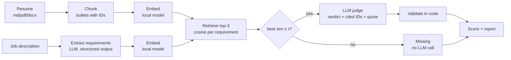

# Resume vs. JD Matcher

Scores a resume against a job description **one requirement at a time**. Embeddings find candidate evidence, an LLM judges it, and code checks that every "met" cites a line that is really in the resume. The output is a weighted score plus an honest gap list: *reword* (evidence exists but is weak) or *real gap* (no evidence).

> Demo GIF: `docs/demo.gif` *(record after the first real run)*

## Why not just ask an LLM, or compare embeddings?

| Approach | Problem |
| --- | --- |
| Whole-document similarity | One opaque number; any Android resume scores well against any Android JD |
| ATS keyword matching | Rewards keyword stuffing |
| "LLM, rate this resume" | Confident matches with no evidence |
| **This tool** | Per-requirement verdicts, each backed by a verbatim resume line checked in code |

## How it works



1. **Chunk** the resume into evidence units with readable IDs (`exp2_b3` = role 2, bullet 3).
2. **Extract** atomic requirements from the JD (must-have vs nice-to-have, years if stated).
3. **Retrieve** the top 3 chunks per requirement by cosine similarity.
4. **Gate**: below threshold τ the requirement is *missing* without an LLM call. τ is tuned on labeled data (`matcher tune`).
5. **Judge**: the LLM sees one requirement and its 3 chunks; returns met / partial / missing, cited chunk IDs and a short verbatim quote.
6. **Validate** (code, not prompt):
   - cited IDs must be chunks the judge was shown;
   - the quote must appear verbatim in a cited chunk, otherwise the verdict becomes *missing*;
   - "met" backed only by a skills-list line is capped at *partial*;
   - years requirements are checked against years computed from role dates.
7. **Score**: `100 × Σ wᵢvᵢ / Σ wᵢ`, must-have w=2, nice-to-have w=1; met=1, partial=0.5, missing=0. Missing must-haves are flagged above the score.

## Setup

```bash
python -m venv .venv && source .venv/bin/activate      # Windows: .venv\Scripts\activate
pip install -e ".[st,dev]"     # [st] = local sentence-transformers embeddings
cp .env.example .env           # then set LLM_BASE_URL, LLM_API_KEY, LLM_MODEL
pytest                         # 30 tests, no API key needed
```

Any OpenAI-compatible endpoint works (Gemini, Groq, OpenAI, OpenRouter, a local server). `.env.example` has examples; check your provider's docs for current model names. If the provider rejects native JSON-schema output, the client falls back to JSON mode, then to schema-in-prompt, and always validates with Pydantic.

## Usage

```bash
matcher chunks -r my_resume.md                         # check chunking on your resume first
matcher score  -r my_resume.md -j jds/acme_android.txt # one JD -> runs/acme_android.md + .json
matcher batch  -r my_resume.md --jds jds/              # rank a folder of JDs -> runs/ranking.md
matcher diff   -r cv_v1.md --resume-b cv_v2.md -j jds/acme_android.txt
matcher tune                                           # suggest THRESHOLD from eval/labels.csv
matcher eval                                           # golden-set eval -> eval/eval_report.md
```

Add `--offline` to any command to run without an API key. It swaps the LLM for simple rules, so it is for trying the pipeline only: **never report offline numbers.**

Markdown resumes chunk most cleanly. PDF and DOCX are supported; run `matcher chunks` to see what the parser produced.

## Engineering details

- **Structured output**: strict JSON schemas (`llm_client.SCHEMAS`), temperature 0, one repair retry on invalid JSON.
- **Retries**: exponential backoff with full jitter on 408/409/429/5xx and connection errors; honours `Retry-After`; no retry on 4xx auth/validation errors.
- **Throttling**: `LLM_MAX_RPM` spaces calls to stay under free-tier limits.
- **Caching**: LLM results and embeddings are cached by SHA-256 of their inputs (`.cache/`), so reruns are free.
- **Cost log**: every call appends model, tokens, cost and latency to `runs/llm_calls.jsonl`.
- **Privacy**: embeddings run locally; only requirement text and the 3 retrieved snippets reach the LLM API.
- **No vector DB**: one resume is ~40–80 chunks; a NumPy matrix product is instant. A vector DB becomes useful for searching many stored JDs (planned).

## Evaluation

See `eval/README.md` for building the golden set. `matcher eval` compares:

| System | What it does |
| --- | --- |
| A. Keyword overlap | Share of requirement terms found in the resume |
| B. Whole-doc cosine | One similarity per resume–JD pair (ranking only) |
| C. Retrieval + threshold | Best chunk similarity per requirement, no LLM |
| D. Full pipeline | C + LLM judge + validator |

Verdict metrics use the labeled requirements directly, so judge errors and extraction errors are measured separately.

### Results

*Fill in from `eval/eval_report.md` after running on your real golden set. Do not copy numbers from offline runs.*

| System | Accuracy | False-match rate | Gap recall |
| --- | --- | --- | --- |
| A. Keyword | [measured]% | [measured]% | [measured]% |
| C. Retrieval | [measured]% | [measured]% | [measured]% |
| D. Pipeline | [measured]% | [measured]% | [measured]% |

[N] labeled requirements across [M] JDs; model [name]; avg cost $[measured] per JD.

### What failed and what I changed

*Write this after reading the false matches listed in `eval/eval_report.md`.*

## Project layout

```
src/matcher/
  cli.py          commands
  config.py       settings from .env
  ingest.py       pdf/docx/md -> text
  chunker.py      text -> evidence chunks with IDs
  experience.py   years from role dates
  extract.py      JD -> requirements (LLM)
  embed.py        local embeddings + cache (hashing fallback)
  retrieve.py     top-k cosine + gate
  judge.py        requirement + chunks -> verdict (LLM)
  validate.py     verbatim evidence checks, downgrades
  score.py        weighted score
  report.py       Markdown reports
  baselines.py    systems A-C
  evaluate.py     golden-set eval, threshold tuning
  llm_client.py   OpenAI-compatible client, retries, cost log, offline stand-in
  prompts/        extraction and judge prompts
eval/             sample golden set (fictional) + eval outputs
tests/            pytest suite
```

## Limitations

- Years of experience are total dated experience, not per technology.
- The small local embedding model can miss paraphrases; τ is tuned for recall so near-misses still reach the judge.
- PDF layouts with columns may chunk poorly; Markdown input is recommended.
